# K_CodexZoo

Black and white pixel dinosaurs for Codex, with crisp 2px outlines and a desktop computer that shows task activity.

## Every animation state

Each preview loops through the complete sequence at its original speed. Both pets appear at their native 192 × 208 size on a dark background. The installable sprites have transparent backgrounds.

| Status | Black dinosaur · Pixel Dino | White dinosaur · Pixel Dino White |
| --- | --- | --- |
| **Idle** — breathing and blinking | 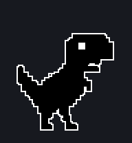 | 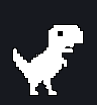 |
| **Running right** — rightward gait | 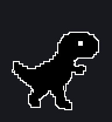 | 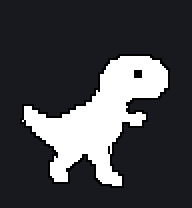 |
| **Running left** — leftward gait | 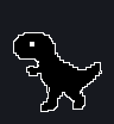 | 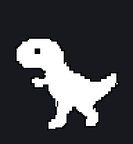 |
| **Waving** — greeting | 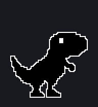 | 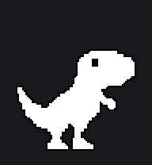 |
| **Jumping** — takeoff and landing | 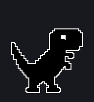 | 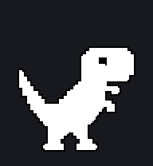 |
| **Failed** — error cross on the monitor | 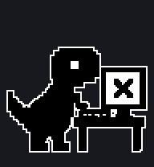 | 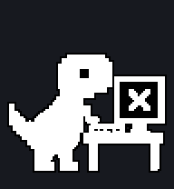 |
| **Waiting** — hourglass on the monitor | 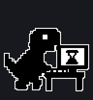 | 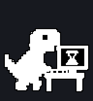 |
| **Working** (`running`) — typing and activity bars | 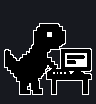 | 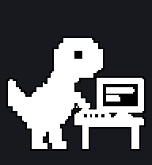 |
| **Review** — inspecting the screen and a completion check | 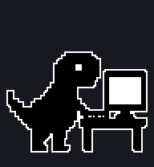 | 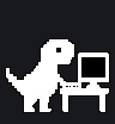 |

## Download and install

- **Black dinosaur:** [Download resource ZIP](output/pixel-dino.zip) · [Installation and file guide](output/pixel-dino/README.txt)
- **White dinosaur:** [Download resource ZIP](output/pixel-dino-white.zip) · [Installation and file guide](output/pixel-dino-white/README.txt)

Extract the chosen ZIP and copy its `pet.json` and `spritesheet.webp` together into the matching folder:

```text
%USERPROFILE%\.codex\pets\pixel-dino\
%USERPROFILE%\.codex\pets\pixel-dino-white\
```

If `CODEX_HOME` is customized, use its `pets` directory instead. Reopen Codex's pet selector and choose **Pixel Dino** or **Pixel Dino White**. Restart Codex if the list does not refresh.

## More previews

- [Both palettes on light and dark backgrounds](output/variants-preview.png)
- All frames: [Black dinosaur](output/pixel-dino/contact-sheet-dark.png) · [White dinosaur](output/pixel-dino-white/contact-sheet-dark.png)
- Interactive players, to download and open locally alongside their sprite sheets: [Black dinosaur](output/pixel-dino/preview.html) · [White dinosaur](output/pixel-dino-white/preview.html)

## Resource format

Each pet uses the Codex v1 sprite format: a 1536 × 1872 atlas, 192 × 208 cells, nine states and 57 animation frames. The optional v2 gaze-direction rows are not included. The `running` state represents active work; `running-right` and `running-left` represent movement.

The artwork is based on the reference in `img/`. Precise pixel processing removes the background grid and rebuilds uniform outlines with binary transparency. The white dinosaur uses the inverse opaque palette. Each pet includes validation and quality reports.

To regenerate the README animations with Python and Pillow installed:

```sh
python tools/render_readme_previews.py
```

The exporter reads each pet's runtime sprite sheet and `animations.json`, preserves frame timing and checks every decoded GIF frame against the source artwork.
